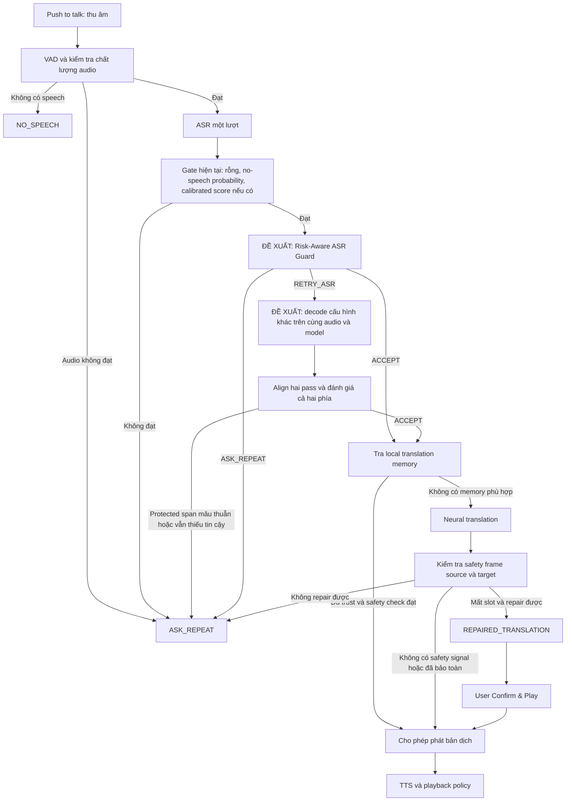
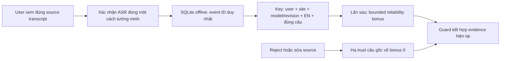

# Workflow VoxBridge — cập nhật 2026-11-15

Nhánh thử nghiệm: `codex/risk-aware-asr-guard`. Risk-Aware Guard hiện chỉ chạy trong experiment Python; Android/Kotlin chưa tích hợp. Mọi nhánh trong sơ đồ có nhãn **đề xuất** cần calibration và acoustic holdout trước khi đưa vào app.

## Luồng hiện tại và vị trí guard đề xuất

App hiện tại đi từ gate ASR thẳng đến local memory; chưa gọi `G`, `R`, `G2`. Raw `exp(mean logP)` của runtime không được so với threshold calibrated. Memory reuse cũng phải qua safety check trực tiếp trước khi phát.

## Guard đánh giá câu như thế nào

1. Đọc lexicon/config riêng, ưu tiên multi-word longest-match: `do not enter` trước `do not` trước `not`. Quantity/ID được giữ thành span, không tách số bên trong ID thành risk độc lập.
2. Tính `risk = importance_weight × uncertainty` cho từng span và lấy **max**, không average. Native word confidence thiếu thì để `null`, không lấy score trung bình toàn câu gán cho mọi từ.
3. Quyết định chỉ xét max risk của HIGH/CRITICAL. LOW/NORMAL riêng lẻ không tạo RETRY/ASK dù chỉnh threshold thấp; HIGH/CRITICAL thiếu evidence hoặc risk chạm ngưỡng thì `RETRY_ASR`.
4. Retry chỉ khi cần, dùng cùng audio hash/model/revision và cấu hình decoding khác. Alignment ưu tiên protected matches trước LOW/NORMAL, kiểm tra cả hai transcript; mất `%`, đổi số, đảo ID cũng được tính. Di chuyển “please” không được làm mất match “open”.
5. Sau retry, mâu thuẫn ở protected spans hoặc native confidence vẫn thấp → `ASK_REPEAT`. Agreement chỉ là heuristic rời rạc, không phải xác suất ASR đã calibration.

`ACCEPT` có nghĩa guard không phát hiện risk cần chặn từ evidence hiện có. ASR bỏ hẳn phủ định ở cả hai pass vẫn có thể lọt; xem [kết quả BTC](BTC_RESULTS.md).

## Nhánh học từ user xác nhận

- Đây là **xác nhận source transcript**, khác với `Approve` bản dịch, `Confirm & Play` bản dịch repair và `Understood`. Không tự biến các nút hiện tại thành nhãn ASR.
- `approval_weight = n / (n + 2)` và `reliability_bonus = 0.15 × approval_weight`, tất cả tham số nằm trong config. Một/hai/ba lần xác nhận cho bonus `0.05 / 0.075 / 0.09`; đây là heuristic prototype.
- Bonus áp dụng cho NORMAL/HIGH có evidence hiện tại; CRITICAL không được giảm risk. Native confidence giữ nguyên. Thiếu confidence quan trọng vẫn cần retry; mâu thuẫn giữa hai pass luôn thắng lịch sử.
- Ví dụ có native confidence `open = 0.45`: risk HIGH gốc `0.8 × 0.55 = 0.44` → retry. Với một lần xác nhận trước đó, risk cá nhân hoá `0.44 − 0.05 = 0.39` → accept theo ngưỡng thử `0.4`. Đây không phải tăng xác suất âm học từ `0.45` lên con số khác.
- Chỉ khớp câu chuẩn hoá case/whitespace/dấu nháy và dấu kết câu; giữ thứ tự, phủ định, số thập phân, ID. Không chuyển trust từ `15` sang `50` hoặc từ `open` sang `not open`.
- Cùng event ID không được tính hai lần. Một reject/source correction vô hiệu bonus của câu gốc; câu đã sửa chỉ được cộng khi được xác nhận riêng. Prototype chưa có quy trình phục hồi sau rejection.

## Trạng thái triển khai

| Thành phần | Trạng thái |
|---|---|
| Detector, risk/max, decision, agreement | Chạy offline trong experiment |
| ASR feedback store và CLI | Chạy offline; API yêu cầu scope và phrase khớp |
| Selective retry coordinator | Đã implement/test callback và replay paired JSON; chưa chạy greedy/beam thật trên BTC |
| Evaluation BTC | Replay 100 output/run, reference chỉ dùng sau quyết định |
| Android integration, UI xác nhận ASR riêng | Chưa triển khai trong phạm vi prototype |
| Calibration, latency và acoustic holdout | Chưa có |

Tài liệu kỹ thuật và cách chạy: [README](README.md). Chi tiết từng câu sai vẫn ACCEPT: [BTC_RESULTS](BTC_RESULTS.md).
